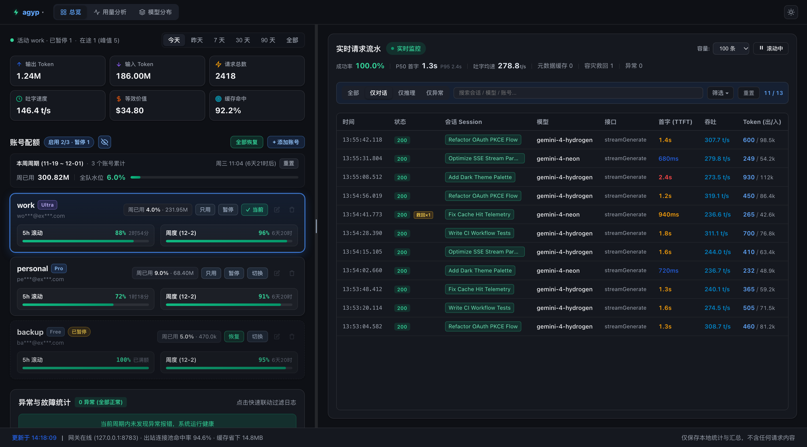
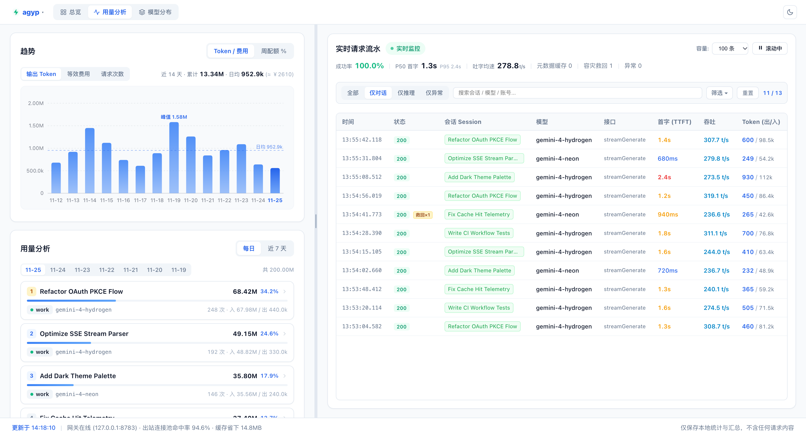
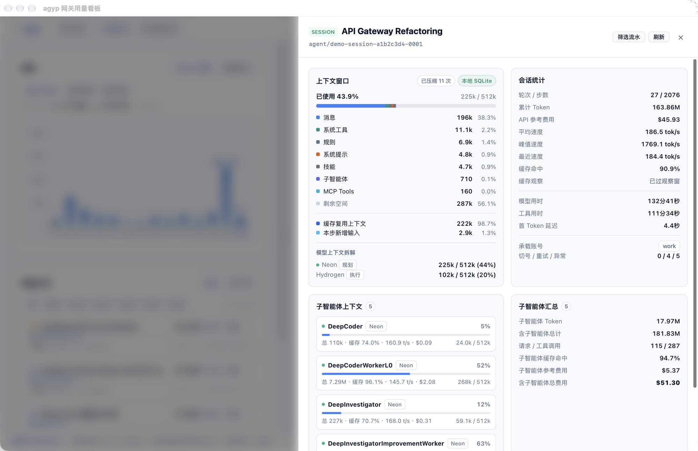
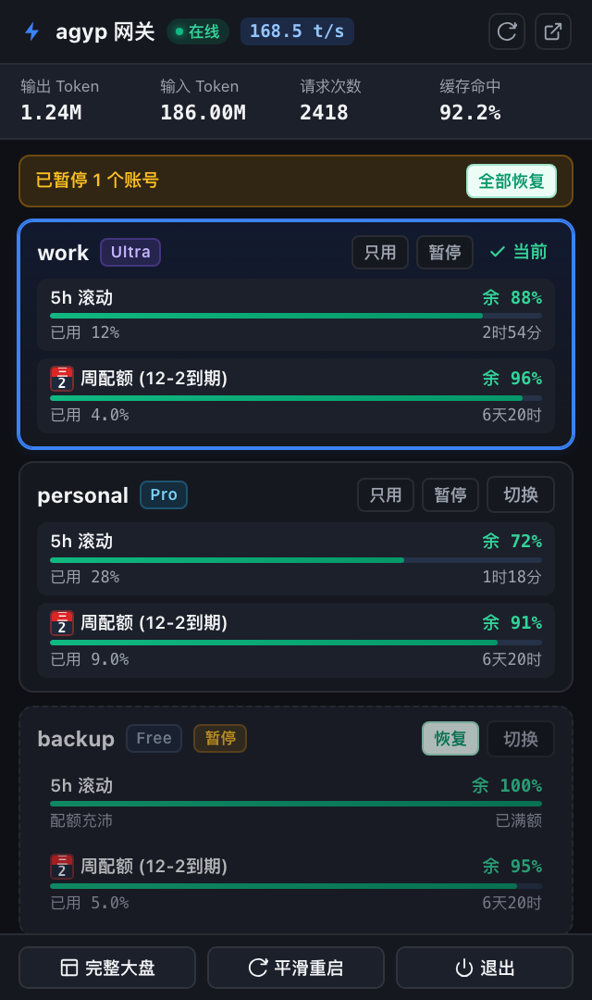
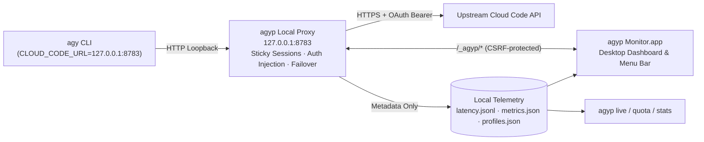

# agyp — Local Gateway & Desktop Monitor for Antigravity (`agy`)

English | [简体中文](README_CN.md)

`agyp` is a lightweight local loopback reverse-proxy gateway, CLI orchestrator, and native macOS desktop monitor for Google Antigravity (`agy`). It gives you clear observability into TTFT latency, pure decode speed (`t/s`), prompt-cache hit rates, and subscription quotas, while enabling smooth switching between your personal and work profiles without modifying the `agy` binary or triggering macOS Keychain prompts.

> **Privacy First**: All telemetry is stored locally (`latency.jsonl`, `metrics.json`) and records **metadata only** (timestamps, model IDs, HTTP statuses, latencies, and token counts). Prompt and response payloads are never persisted or transmitted anywhere outside upstream Google endpoints.

## Screenshots

> All screenshots below use synthetic demo profiles with Privacy Mode enabled.

### Overview & Live Stream (Dark Mode)



### Usage Trends & Session Breakdown (Light Mode)



### Session Context, Timing & Subagent Inspector (Light Mode)



### macOS Menu Bar Flyout

<p align="center">
  
</p>

## Architecture



## Features

- **Transparent Loopback Proxy (`127.0.0.1:8783`)**: Injects OAuth Bearer tokens dynamically at runtime and fails over gracefully on `429` / `403` / `503` without interrupting active sessions.
- **Session Stickiness & Prompt Cache Preservation**: Pins active `agent/<uuid>` conversations to the same profile to protect KV prompt-cache hit rates; transient transport errors retry on the same profile first before optional cross-account fallback.
- **Account Lifecycle Management**:
  - `agyp add <name>`: Browser PKCE OAuth login, `--from-keychain` import (macOS), or `--refresh-token` import.
  - `agyp reauth <name>`, `agyp rename <old> <new>`, `agyp remove <name>`.
  - `agyp pause <name...>`, `agyp resume <name|all>`, `agyp only <name>`, `agyp switch <name>`.
- **Accurate Telemetry & Observability**:
  - Splits **TTFT** (`head_ms`) from pure **decode throughput** (`(output + thoughts) / stream_ms`, displayed in `t/s`) alongside end-to-end throughput.
  - Tracks `thoughtsTokenCount`, prompt-cache hit percentages, and subscription tiers (`Ultra` / `Pro` / `Free`).
  - On-demand **Session Context & Subagent Inspector** (context category breakdown, compaction count, model/tool time split, and subagent rollup) plus short-interval **cache-drop anomaly detection**.
  - Interactive live TUI (`agyp live`), quota/stats (`agyp quota`, `agyp stats`), intelligence probe (`agyp check`), and native desktop UI (`agyp gui`).
- **Desktop Monitor App & Menu Bar Flyout**:
  - Light & neutral-charcoal Dark mode synced natively with macOS window appearance.
  - Built-in Privacy Mode toggle (masks profile emails by default—keep it enabled when sharing screenshots).

> Tip: Before capturing screenshots to share or open issues, toggle the **Privacy (eye)** icon next to Account Quotas to mask email addresses.

## Quick Start

### 1. Install CLI & Scripts

```bash
git clone https://github.com/timeonelab/agyp.git
cd agyp
./scripts/install.sh
```

Ensure `~/.local/bin` is in your `PATH`.

### 2. Configure OAuth Client & Add Accounts

Option A — Import an already signed-in `agy` session from macOS Keychain:

```bash
agyp add work --from-keychain
```

Option B — Configure your own Google OAuth Desktop Client (`~/.agyp/oauth.json`, mode `0600`) and sign in via browser PKCE:

```bash
agyp auth config --client-id "<YOUR_CLIENT_ID>" --client-secret "<YOUR_CLIENT_SECRET>"
agyp add work
```

You can also provide credentials via `AGYP_OAUTH_CLIENT_ID` and `AGYP_OAUTH_CLIENT_SECRET`, or pass `--refresh-token` directly:

```bash
agyp add personal --refresh-token "<REFRESH_TOKEN>"
```

### 3. Run

```bash
agyp                 # Launch agy through the local gateway using best available profile
agyp work            # Launch agy pinned to "work"
agyp quota           # Show 5h / weekly quotas and tiers
agyp stats 7         # 7-day token, cache hit rate, decode speed, and equivalent cost breakdown
agyp live            # Real-time traffic & session binding monitor
agyp gui             # Open the desktop Monitor app
```

### Install Desktop Monitor (`agyp Monitor.app`)

**Option A — Download Prebuilt App (macOS, no Go required)**

Download `agyp-Monitor-macos-universal.zip` (Apple Silicon + Intel) from GitHub **Releases**, unzip it, and drag `agyp Monitor.app` into `/Applications`.

Because release builds use ad-hoc signing rather than Apple Developer notarization, run this once in Terminal if macOS Gatekeeper blocks first launch:

```bash
xattr -cr "/Applications/agyp Monitor.app"
```

Once placed in `/Applications` (or built locally), `agyp gui` launches the `.app` bundle automatically.

**Option B — Build from Source**

Requires Go 1.27+ (builds directly against public [`github.com/egoist/mygo`](https://github.com/egoist/mygo)):

```bash
make app       # Build and ad-hoc sign desktop/bin/agyp Monitor.app
# or: cd desktop && go build -o bin/agyp-desktop .
```

Or run `make desktop` / `make test`.

## CLI Reference

| Command | Description |
| :--- | :--- |
| `agyp add <name>` | Add profile via browser OAuth (`--from-keychain` / `--refresh-token`) |
| `agyp reauth <name>` | Re-authenticate an existing profile |
| `agyp rename <old> <new>` | Rename a profile alias |
| `agyp remove <name>` | Remove a profile (`-y`, `--force`) |
| `agyp auth status \| config` | View or set Google OAuth client credentials |
| `agyp switch <name>` | Hot-switch active profile (clears stale session bindings) |
| `agyp pause <name...>` | Pause profile(s) from routing and failover |
| `agyp resume <name\|all>` | Resume paused profile(s) |
| `agyp only <name>` | Lock gateway to a single active profile |
| `agyp daemon start\|stop\|restart\|status` | Manage background gateway daemon |
| `agyp check [profile] [-t milk\|pelican\|all]` | Run model quality / intelligence regression probes |

## Environment Variables

| Variable | Default | Purpose |
| :--- | :--- | :--- |
| `AGYP_HOME` | `~/.agyp` | Override data/config/log directory |
| `AGYP_OAUTH_CLIENT_ID` / `AGYP_OAUTH_CLIENT_SECRET` | `""` | Google OAuth client credentials (alternative to `~/.agyp/oauth.json`) |
| `AGYP_UPSTREAM_PROXY` | system proxy | Explicit HTTP proxy (`host:port` / `http://...`, or `none`) |
| `AGYP_ADMIN_TOKEN` | `""` | Optional bearer token (`X-Agyp-Token`) required for mutating `/_agyp/*` endpoints |
| `AGYP_LAUNCHD_LABEL` | `io.agyp.gateway` | Custom macOS LaunchAgent label |
| `AGYP_REAL_AGY_BIN` | `which agy` | Path to upstream `agy` binary |
| `AGYP_TRANSPORT_FAILOVER` | `0` | Set `1` to allow cross-account failover on transport errors |
| `AGYP_POOL_DISABLE` / `AGYP_CACHE_DISABLE` | `0` | Disable outbound TLS pooling or HTTP metadata cache |

## Development & Tests

```bash
make test        # Runs JS syntax check, Go unit tests, and sandboxed Python hardening suite
```

## Security & Privacy

See [SECURITY.md](SECURITY.md) for loopback binding, CSRF Origin protection, credential file permissions, and vulnerability reporting.

## Acknowledgments

- Built with [mygo](https://github.com/egoist/mygo) for the lightweight native macOS desktop window, menu bar tray, popover flyout, and native light/dark appearance sync.

## License & Disclaimer

Released under the [MIT License](LICENSE). This project is an independent local developer observability and profile-switching utility and is not affiliated with or endorsed by Google. Please use it only with your own authorized accounts and in accordance with applicable Terms of Service and usage policies.
