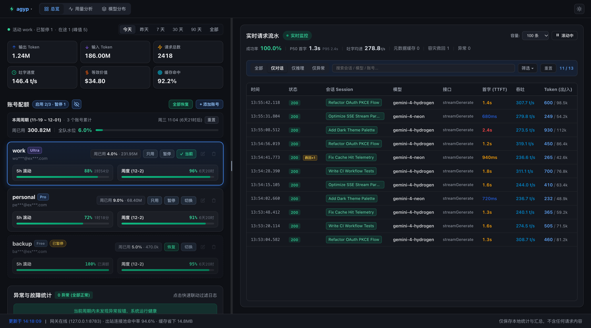
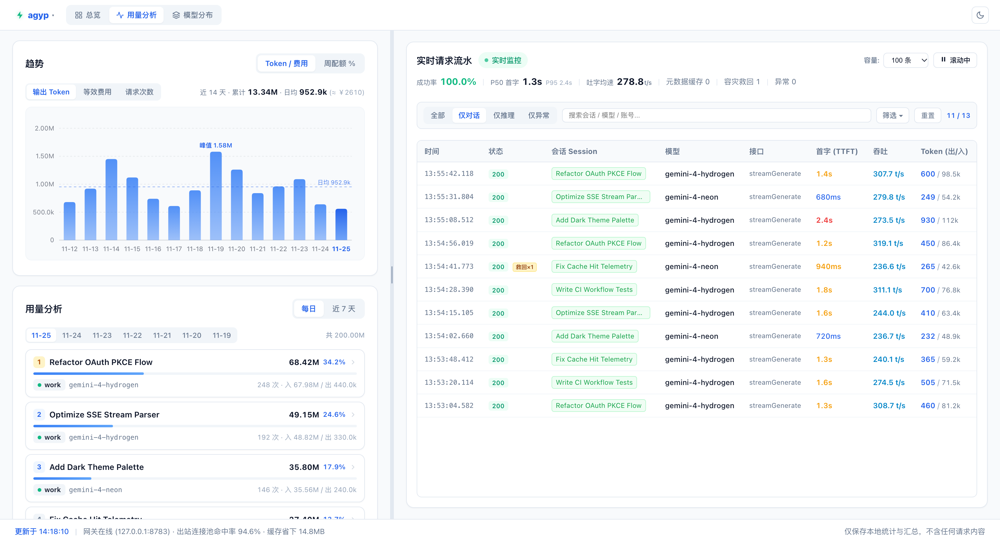
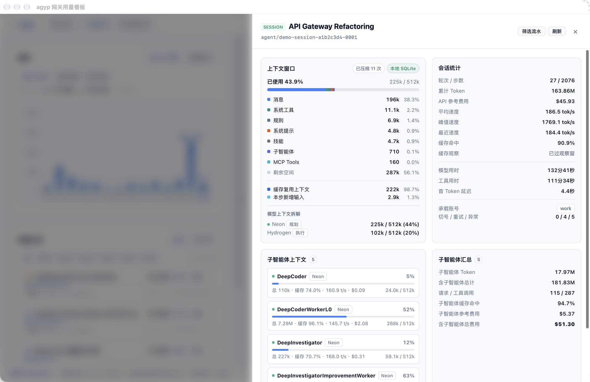
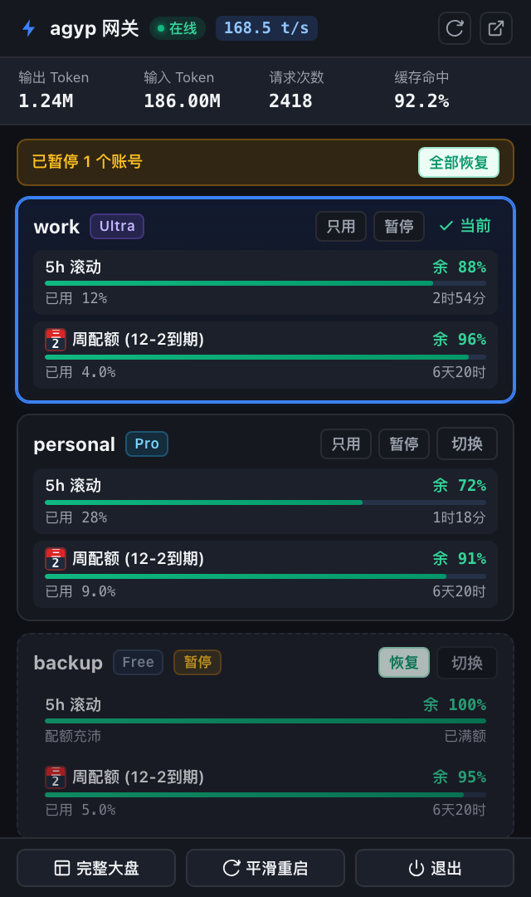
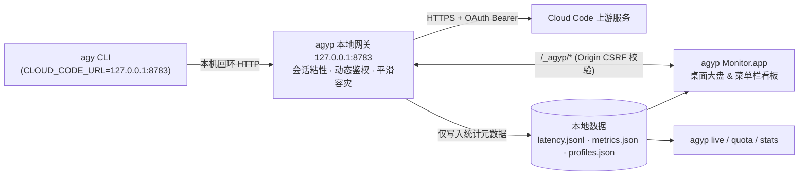

# agyp — Antigravity (`agy`) 本地代理网关与桌面监控看板

[English](README.md) | 简体中文

`agyp` 是专为 Google Antigravity（`agy`）打造的轻量级本机回环反向代理网关、CLI 编排工具与原生 macOS 桌面监控看板。它无需修改官方 `agy` 二进制文件、也不会频繁触发系统钥匙串弹窗，即可实现工作/个人账号平滑热切换，并提供首字延迟（TTFT）、纯吐字速率（`t/s`）、Prompt 缓存命中率与配额消耗的可观测性分析。

> **隐私承诺**：所有本地统计文件（`latency.jsonl`、`metrics.json`）仅保存请求元数据（时间戳、模型名、HTTP 状态码、耗时、Token 计数），**绝不记录或上传任何 Prompt 与响应正文**。

## 界面预览

> 以下预览截图均使用脱敏示例账号与合成数据在隐私模式下生成。

### 监控总览与实时流水（暗黑模式）



### 趋势图表与会话排行（浅色模式）



### 会话上下文拆解与子智能体透视（浅色模式）



### macOS 菜单栏快捷看板

<p align="center">
  
</p>

## 工作架构



## 核心特性

- **本机透明回环代理（`127.0.0.1:8783`）**：请求转发时动态注入 OAuth Bearer Token；遇到 `429` / `403` / `503` 时可在当前终端会话不中断的前提下无缝容灾重试。
- **会话粘性与上下文缓存保护**：将同一个 `agent/<uuid>` 会话稳定绑定到同一上游账号，避免频繁切号破坏 KV Prompt Cache；瞬时网络抖动默认先在原账号重试。
- **完整账号生命周期管理**：
  - `agyp add <name>`：支持浏览器 PKCE OAuth 登录、`--from-keychain`（macOS 钥匙串导入）及 `--refresh-token` 导入。
  - `agyp reauth <name>`、`agyp rename <old> <new>`、`agyp remove <name>`。
  - `agyp pause <name...>`、`agyp resume <name|all>`、`agyp only <name>`（单号锁定）、`agyp switch <name>`（热切换）。
- **精准可观测性指标**：
  - 将 **首字延迟（TTFT / `head_ms`）** 与 **纯吐字速率（`t/s`）** 严格拆分，合并统计 `thoughtsTokenCount` 思考 Token、缓存命中率与订阅等级（`Ultra` / `Pro` / `Free`）。
  - 点击实时流水或热门会话可按需透视 **会话上下文窗口拆解、模型/工具耗时、嵌套子智能体汇总**，并支持短间隔 **异常掉缓存检测**。
  - 提供终端实时监控 `agyp live`、配额面板 `agyp quota`、多维统计 `agyp stats`、模型回归探针 `agyp check` 与桌面看板 `agyp gui`。
- **原生桌面看板与菜单栏 Popover**：
  - 支持浅色与中性深灰暗黑模式（原生同步 macOS 窗口标题栏与弹出面板外观）。
  - 默认开启邮箱脱敏隐私模式（截图分享或提交 Issue 前请保持开启）。

## 快速开始

### 1. 安装 CLI 与配套脚本

```bash
git clone https://github.com/timeonelab/agyp.git
cd agyp
./scripts/install.sh
```

请确保 `~/.local/bin` 已加入你的 `PATH`。

### 2. 配置 OAuth 客户端并添加账号

方式 A — 从 macOS 钥匙串直接导入当前已登录的 `agy` 会话：

```bash
agyp add work --from-keychain
```

方式 B — 配置你自己的 Google OAuth 桌面端凭据（保存在 `~/.agyp/oauth.json`，权限 `0600`）并通过浏览器登录：

```bash
agyp auth config --client-id "<YOUR_CLIENT_ID>" --client-secret "<YOUR_CLIENT_SECRET>"
agyp add work
```

也可以通过环境变量 `AGYP_OAUTH_CLIENT_ID` / `AGYP_OAUTH_CLIENT_SECRET` 传入，或直接导入 Refresh Token：

```bash
agyp add personal --refresh-token "<REFRESH_TOKEN>"
```

### 3. 日常使用

```bash
agyp                 # 自动选择最优可用账号，经本地网关启动 agy
agyp work            # 固定使用 "work" 账号启动 agy
agyp quota           # 查看 5h 滚动与周配额水位
agyp stats 7         # 查看近 7 天 Token、缓存命中率、吐字速率与等效费用
agyp live            # 终端实时流量与会话粘性监控
agyp gui             # 打开桌面监控看板
```

### 安装桌面监控看板（`agyp Monitor.app`）

**方式 A — 直接下载预编译包（macOS 免安装 Go）**

前往 GitHub **Releases** 下载 `agyp-Monitor-macos-universal.zip`（Apple Silicon + Intel 通用包），解压后将 `agyp Monitor.app` 拖入「应用程序（`/Applications`）」。

由于开源发行包使用本机 ad-hoc 签名（未经 Apple 开发者公证），首次双击如遇系统安全拦截，在终端执行一次：

```bash
xattr -cr "/Applications/agyp Monitor.app"
```

放入 `/Applications` 或源码编译后，执行 `agyp gui` 会自动优先拉起 `agyp Monitor.app`。

**方式 B — 从源码编译**

需要 Go 1.27+（直接拉取公开的 [`github.com/egoist/mygo`](https://github.com/egoist/mygo)）：

```bash
make app       # 编译并签名生成 desktop/bin/agyp Monitor.app
# 或仅编译可执行文件：cd desktop && go build -o bin/agyp-desktop .
```

也可直接执行 `make desktop` / `make test`。

## 常用命令参考

| 命令 | 说明 |
| :--- | :--- |
| `agyp add <name>` | 新增账号（支持浏览器 OAuth / `--from-keychain` / `--refresh-token`） |
| `agyp reauth <name>` | 为已有账号重新授权 |
| `agyp rename <old> <new>` | 重命名账号别名 |
| `agyp remove <name>` | 移除账号（`-y` / `--force`） |
| `agyp auth status \| config` | 查看或配置 Google OAuth 客户端凭据 |
| `agyp switch <name>` | 运行中热切换默认账号 |
| `agyp pause <name...>` | 暂停指定账号参与调度 |
| `agyp resume <name\|all>` | 恢复已暂停的账号 |
| `agyp only <name>` | 锁定仅使用单个指定账号 |
| `agyp daemon start\|stop\|restart\|status` | 管理后台网关守护进程 |
| `agyp check [profile] [-t milk\|pelican\|all]` | 执行模型可用性与智能度回归探针 |

## 环境变量

| 变量名 | 默认值 | 说明 |
| :--- | :--- | :--- |
| `AGYP_HOME` | `~/.agyp` | 自定义数据、配置与日志目录 |
| `AGYP_OAUTH_CLIENT_ID` / `AGYP_OAUTH_CLIENT_SECRET` | `""` | Google OAuth 客户端凭据（替代 `~/.agyp/oauth.json`） |
| `AGYP_UPSTREAM_PROXY` | 跟随系统代理 | 手动指定上游 HTTP 代理（`host:port` / `http://...`，或 `none` 禁用） |
| `AGYP_ADMIN_TOKEN` | `""` | 可选的管理接口鉴权 Token（`/_agyp/*` 写操作校验 `X-Agyp-Token`） |
| `AGYP_LAUNCHD_LABEL` | `io.agyp.gateway` | 自定义 macOS LaunchAgent 标签 |
| `AGYP_REAL_AGY_BIN` | `which agy` | 上游 `agy` 可执行文件路径 |
| `AGYP_TRANSPORT_FAILOVER` | `0` | 设为 `1` 允许传输层故障跨账号重试 |
| `AGYP_POOL_DISABLE` / `AGYP_CACHE_DISABLE` | `0` | 关闭出站 TLS 连接池或本地 HTTP 元数据缓存 |

## 测试与开发

```bash
make test        # 运行 JS 语法检查、Go 单元测试以及沙箱 Python 网关加固回归测试
```

## 安全与隐私说明

详见 [SECURITY.md](SECURITY.md)（含回环绑定隔离、CSRF Origin 校验、凭证文件权限与漏洞反馈方式）。

## 致谢

- 感谢 [mygo](https://github.com/egoist/mygo) 提供轻量级的原生 macOS 桌面窗口、菜单栏托盘/Popover 悬浮窗以及深浅色外观原生同步能力。

## 开源协议与免责声明

本项目基于 [MIT License](LICENSE) 开源。它是独立的本地开发者可观测性与账号切换辅助工具，与 Google 官方无任何关联或背书。请仅在个人合法授权账号下遵循服务条款与配额政策使用。
